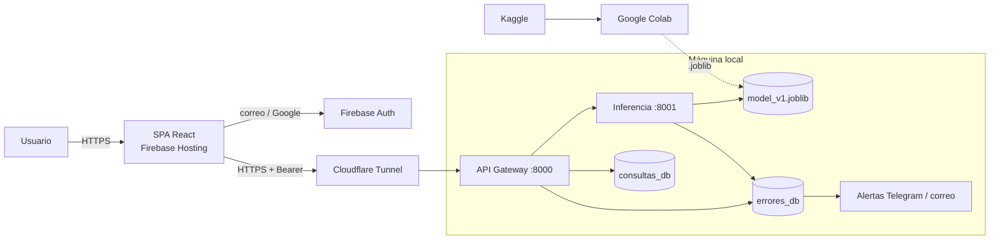

# 🧠 Stroke Risk App — Predicción de riesgo de derrame cerebral

Aplicación web híbrida (nube + máquina local) en la que el usuario ingresa sus datos de salud y obtiene la
**probabilidad estimada de sufrir un derrame cerebral (stroke)**, con histórico de consultas.

[](https://colab.research.google.com/github/chavmoreno/APP_HIBRIDA/blob/main/ml/stroke_prediction_colab.ipynb)

> ⚠️ Herramienta educativa y orientativa. **No sustituye un diagnóstico médico.**

## Características

- 🔒 **HTTPS exclusivo** de punta a punta (Firebase Hosting, Cloudflare Tunnel y TLS local con mkcert).
- 👤 **Firebase Authentication**: registro e inicio de sesión con correo/contraseña (con verificación de correo) o con Google (Gmail).
- 🧪 **Modelo entrenado en Google Colab** con el dataset de Kaggle leído directamente con `kagglehub`; EDA,
  imputación **moda** (categóricas) / **mediana** (numéricas), comparación de modelos y probabilidades calibradas.
- 🖥️ **Pesos del modelo en un microservicio local** (FastAPI, `:8001`, sólo `127.0.0.1`).
- 🗄️ **XAMPP / MySQL**: `consultas_db` (consultas y resultados) y `errores_db` (log de errores) con usuarios de privilegios mínimos.
- 🗂️ **Frontend** con pestañas **Nueva consulta** e **Histórico**, páginas 404/401/500 y `ErrorBoundary`.
- 🚨 **Log de errores centralizado** (gateway, inferencia y frontend) con `X-Request-ID`, respaldo en archivo rotativo y alertas de errores críticos por Telegram/correo.
- 📘 **Swagger/OpenAPI** generado desde el código.

## Arquitectura



Detalle completo, flujos, seguridad y modelo de datos: **[docs/arquitectura.md](docs/arquitectura.md)**.

## Estructura del repositorio

```
APP_HIBRIDA/
├── ml/                       # Notebook de Colab (EDA + entrenamiento) y conversor .py → .ipynb
├── inference-service/        # Microservicio FastAPI :8001 que carga el .joblib (model registry en models/)
├── api-gateway/              # API pública FastAPI :8000: auth Firebase, consultas, errores, admin, alertas
├── frontend/                 # SPA React + Vite para Firebase Hosting
├── database/                 # Scripts SQL de consultas_db, errores_db y usuarios MySQL
├── infra/                    # Plantilla de Cloudflare Tunnel e instrucciones de certificados (mkcert)
├── scripts/                  # Arranque de servicios y exportación de OpenAPI
└── docs/                     # Arquitectura, manuales, modelo y Swagger (docs/api/)
```

## Inicio rápido

1. **Entrenar** — abre el notebook en Colab (botón de arriba), *Ejecutar todo* y copia `model_v1.joblib` a `inference-service/models/`.
2. **Bases de datos** — ejecuta `database/01…03_*.sql` en XAMPP (cambia antes las contraseñas).
3. **Certificados** — `mkcert` en `infra/certs/` ([instrucciones](infra/certs/README.md)).
4. **Servicios locales** — en `inference-service/` y `api-gateway/`: `python -m venv .venv`, `pip install -r requirements.txt`, copia `.env.example` → `.env`, `python run.py`.
5. **Túnel** — `cloudflared` con [`infra/cloudflared/config.yml.example`](infra/cloudflared/config.yml.example).
6. **Frontend** — `cd frontend && npm ci`, `.env.example` → `.env.local`, `npm run deploy`.

Paso a paso completo: **[docs/manual_instalacion.md](docs/manual_instalacion.md)**.

## Documentación

| Documento | Para quién |
|---|---|
| [Arquitectura](docs/arquitectura.md) | Desarrolladores / arquitectura |
| [Manual de instalación y despliegue](docs/manual_instalacion.md) | Quien instala y opera |
| [Manual de usuario](docs/manual_usuario.md) | Usuarios finales |
| [Modelo de ML](docs/modelo.md) | Ciencia de datos |
| [API — Swagger / OpenAPI](docs/api/README.md) | Integradores |

## Pruebas

```bash
cd inference-service && pip install -r requirements-dev.txt && pytest
cd api-gateway && pip install -r requirements-dev.txt && pytest
cd frontend && npm ci && npm run build
```

## Stack

Python 3.11+ · FastAPI · scikit-learn 1.6.1 · SQLAlchemy · PyMySQL · firebase-admin ·
React 19 · Vite 6 · Firebase JS SDK 11 · MySQL/MariaDB (XAMPP) · Cloudflare Tunnel · Google Colab · Kaggle.
