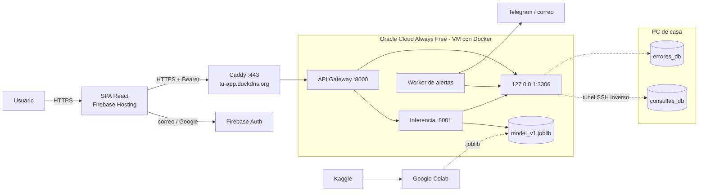

# 🧠 Stroke Risk App — Predicción de riesgo de derrame cerebral

Aplicación web híbrida (nube + base de datos local) en la que el usuario ingresa sus datos de salud y obtiene la
**probabilidad estimada de sufrir un derrame cerebral (stroke)**, con histórico de consultas.

[](https://colab.research.google.com/github/chavmoreno/APP_HIBRIDA/blob/main/ml/stroke_prediction_colab.ipynb)

> ⚠️ Herramienta educativa y orientativa. **No sustituye un diagnóstico médico.**

**En línea:** app <https://app-hibrida-511815.web.app> · API <https://stroke-salva.duckdns.org/api/health> ·
Swagger <https://app-hibrida-511815.web.app/swagger/> · Encender y apagar: [INSTRUCCIONES_INICIO_FIN.md](INSTRUCCIONES_INICIO_FIN.md)

## Características

- 🔒 **HTTPS exclusivo** de punta a punta (Firebase Hosting, Caddy + Let's Encrypt y TLS interno con CA propia en la VM).
- 👤 **Firebase Authentication**: registro e inicio de sesión con correo/contraseña (con verificación de correo) o con Google (Gmail).
- 🧪 **Modelo entrenado en Google Colab** con el dataset de Kaggle leído directamente con `kagglehub`; EDA,
  imputación **moda** (categóricas) / **mediana** (numéricas), comparación de modelos y probabilidades calibradas.
- ☁️ **Backend en Docker sobre Oracle Cloud Always Free** (VM ARM, **USD 0**): API Gateway, microservicio de inferencia (`:8001`, sólo `127.0.0.1`; los pesos se montan como volumen, no van en la imagen) y worker de alertas.
- 🗄️ **XAMPP / MySQL en el PC de casa** (lo único local): `consultas_db` y `errores_db` con usuarios de privilegios mínimos, alcanzables desde la VM por un **túnel SSH inverso** que abre el propio PC (sin abrir puertos ni instalar nada).
- 🗂️ **Frontend** con pestañas **Nueva consulta** e **Histórico**, páginas 404/401/500 y `ErrorBoundary`.
- 🚨 **Log de errores centralizado** (gateway, inferencia y frontend) con `X-Request-ID`, respaldo en archivo rotativo y alertas de errores críticos por Telegram/correo.
- 📘 **Swagger/OpenAPI** generado desde el código y publicado en <https://app-hibrida-511815.web.app/swagger/>.

## Arquitectura



Detalle completo, flujos, seguridad y modelo de datos: **[docs/arquitectura.md](docs/arquitectura.md)**.

## Estructura del repositorio

```
APP_HIBRIDA/
├── ml/                       # Notebook de Colab (EDA + entrenamiento) y conversor .py → .ipynb
├── docker-compose.yml        # Contenedores de la VM: inferencia, gateway y alertas
├── inference-service/        # Microservicio FastAPI :8001 + Dockerfile (model registry en models/)
├── api-gateway/              # API pública FastAPI :8000 + Dockerfile: auth Firebase, consultas, errores, admin, alertas
├── frontend/                 # SPA React + Vite para Firebase Hosting
├── database/                 # Scripts SQL de consultas_db, errores_db y usuarios MySQL
├── infra/                    # oracle/instalar_vm.sh (prepara la VM), caddy/Caddyfile y certs/ (TLS interno)
├── scripts/                  # Túnel de MySQL (Windows), utilidades de XAMPP y exportación de OpenAPI
└── docs/                     # Arquitectura, manuales, modelo y Swagger (docs/api/)
```

## Inicio rápido

1. **Entrenar** — abre el notebook en Colab (botón de arriba) y *Ejecutar todo*: descarga `model_v1.joblib`.
2. **Bases de datos (PC)** — ejecuta `database/01…03_*.sql` en XAMPP (cambia antes las contraseñas).
3. **VM en Oracle Cloud Always Free** — Ampere A1 (1 OCPU, 6 GB) con Ubuntu 24.04 y puertos 80/443 abiertos.
4. **Dominio** — subdominio gratuito en DuckDNS apuntando a la IP de la VM.
   Sube con `scp` los `.env` y la cuenta de servicio de Firebase, clona el repo y ejecuta
   `sudo bash infra/oracle/instalar_vm.sh "<llave pública del PC>" tu-app.duckdns.org tu-correo`.
5. **Túnel de MySQL (PC)** — IP de la VM en `secrets\vm_ip.txt` y doble clic en `scripts\tunel_mysql.bat`.
6. **Frontend** — desde Google Cloud Shell: `npm ci` y deploy a Firebase Hosting.

Paso a paso completo: **[docs/manual_instalacion.md](docs/manual_instalacion.md)**.

**Costo: USD 0.** VM, disco e IP pública en Oracle Cloud Always Free; dominio en DuckDNS; HTTPS de Let's Encrypt;
Firebase en el plan Spark. Detalle en el manual, §12.

## Documentación

| Documento | Para quién |
|---|---|
| [Arquitectura](docs/arquitectura.md) | Desarrolladores / arquitectura |
| [Manual de instalación y despliegue](docs/manual_instalacion.md) | Quien instala y opera |
| [Encender y apagar la app / costos](INSTRUCCIONES_INICIO_FIN.md) | Uso diario del proyecto |
| [Qué es cada archivo](docs/archivos_repositorio.md) | Quien revisa el código |
| [Manual de usuario](docs/manual_usuario.md) | Usuarios finales |
| [Modelo de ML](docs/modelo.md) | Ciencia de datos |
| [API — Swagger / OpenAPI](docs/api/README.md) | Integradores |

## Pruebas

En Google Cloud Shell (no hace falta instalar nada en el PC):

```bash
cd inference-service && pip install -r requirements-dev.txt && pytest
cd api-gateway && pip install -r requirements-dev.txt && pytest
cd frontend && npm ci && npm run build
```

## Stack

Python 3.12 · FastAPI · scikit-learn 1.6.1 · Docker · Oracle Cloud (Ampere A1) · SQLAlchemy · PyMySQL · firebase-admin ·
React 19 · Vite 6 · Firebase JS SDK 11 · MariaDB de XAMPP · OpenSSH · Caddy · DuckDNS · Google Colab · Kaggle.
