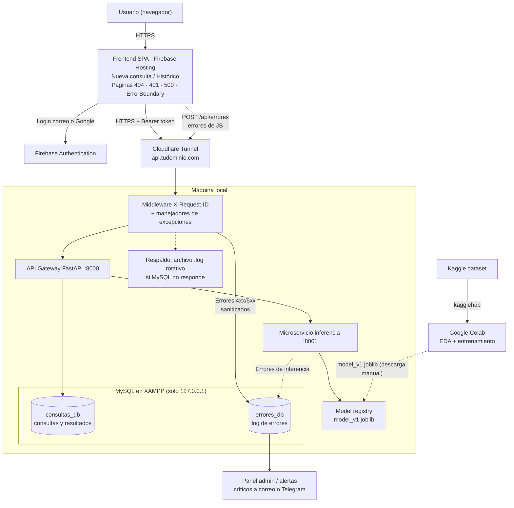
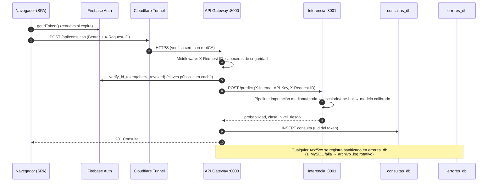

# Arquitectura

Documento de arquitectura de **Stroke Risk App**. Fuente del diagrama original: `Arquitectura.drawio` en Google Drive.

## 1. Vista general

## 2. Componentes

| Componente | Tecnología | Ubicación | Código |
|---|---|---|---|
| Frontend SPA | React 19 + Vite, Firebase JS SDK | Firebase Hosting (HTTPS) | `frontend/` |
| Autenticación | Firebase Authentication (correo/contraseña + Google) | GCP | `frontend/src/context/AuthContext.jsx`, `api-gateway/app/auth.py` |
| Túnel | Cloudflare Tunnel (`cloudflared`) | Máquina local → Cloudflare | `infra/cloudflared/` |
| API Gateway | FastAPI, uvicorn (TLS) | `https://127.0.0.1:8000` | `api-gateway/` |
| Microservicio de inferencia | FastAPI, scikit-learn | `https://127.0.0.1:8001` (no publicado) | `inference-service/` |
| Model registry | Archivos `.joblib` versionados | `inference-service/models/` | — |
| `consultas_db` | MySQL/MariaDB (XAMPP) | `127.0.0.1:3306` | `database/01_consultas_db.sql` |
| `errores_db` | MySQL/MariaDB (XAMPP) | `127.0.0.1:3306` | `database/02_errores_db.sql` |
| Respaldo de logs | `RotatingFileHandler` (5 × 5 MB) | `*/logs/errores_respaldo.log` | `app/error_logger.py` |
| Panel admin / alertas | Ruta `/admin` + worker `app.alertas` | Local | `api-gateway/app/routers/admin.py`, `app/alertas.py` |
| Entrenamiento | Notebook Colab + `kagglehub` | Google Colab | `ml/` |

## 3. Flujos principales

### 3.1 Crear consulta

### 3.2 Errores

| Origen | Cómo llega a `errores_db` | Severidad |
|---|---|---|
| Gateway — `HTTPException` (401, 403, 404, 429…) | Manejador global | `WARNING` (4xx) / `ERROR` (5xx) |
| Gateway — validación 422 | Manejador global; **sólo nombres de campo**, nunca valores (datos de salud) | `WARNING` |
| Gateway — excepción no controlada | Manejador global con stack trace; al cliente sólo `request_id` | `ERROR` |
| Gateway — inferencia caída | Ruta `/api/consultas` | `CRITICAL` → alerta |
| Inferencia — fallo al cargar modelo | `lifespan` | `CRITICAL` → alerta |
| Inferencia — excepción al predecir | Manejador global | `ERROR` |
| Frontend — `ErrorBoundary`, `window.onerror`, `unhandledrejection` | `POST /api/errores` (límite 30/min por IP y 20 por sesión) | `ERROR` |

El **worker de alertas** (`python -m app.alertas`) revisa cada 60 s las filas `CRITICAL` con `notificado = 0`,
las envía por Telegram y/o correo (SMTP con STARTTLS) y las marca como notificadas.

### 3.3 Entrenamiento y despliegue del modelo

1. Abrir `ml/stroke_prediction_colab.ipynb` en Colab → *Ejecutar todo*.
2. El notebook lee el dataset de Kaggle con `kagglehub` (sin descarga manual), hace EDA, preprocesa, compara modelos, calibra y exporta `model_v1.joblib`.
3. Copiar el `.joblib` a `inference-service/models/` y reiniciar el microservicio.
4. Nueva versión → `model_v2.joblib` + cambiar `MODEL_PATH`. Cada consulta guarda `modelo_version`.

Detalle del modelo: [`modelo.md`](modelo.md).

## 4. Seguridad

| Control | Implementación |
|---|---|
| **HTTPS exclusivo** | Firebase Hosting sólo sirve HTTPS + HSTS (`firebase.json`). Cloudflare termina TLS público. Gateway e inferencia arrancan **sólo** con certificado (`run.py` aborta sin él). Gateway → inferencia y Cloudflare → gateway verifican el certificado con la CA de mkcert (nunca `verify=False`/`noTLSVerify`). El frontend rechaza una `VITE_API_URL` que no sea `https://` y redirige `http:` → `https:`. |
| Autenticación | ID token de Firebase verificado en cada petición (firma, expiración, audiencia, **revocación**). Cuentas de correo deben verificar el email. |
| Autorización | Las consultas siempre se filtran por el `uid` del token (un usuario nunca ve consultas ajenas; 404 en vez de 403 para no revelar existencia). Panel admin restringido a `ADMIN_EMAILS` con email verificado. |
| Superficie expuesta | Sólo el gateway se publica (vía túnel, sin abrir puertos). Inferencia y MySQL escuchan en `127.0.0.1`. `TrustedHostMiddleware` rechaza Host inesperados. |
| Servicio a servicio | `X-Internal-API-Key` comparada en tiempo constante. |
| Base de datos | Usuarios con privilegios mínimos (`app_errores` sólo `INSERT`; `app_errores_admin` sólo `SELECT` + `UPDATE(notificado)`). Consultas parametrizadas (SQLAlchemy `text()` con parámetros). |
| Cabeceras | HSTS, `X-Content-Type-Options`, `X-Frame-Options: DENY`, `Referrer-Policy`, CSP, `Cache-Control: no-store` en la API. |
| CORS | Sólo orígenes `https://` de Firebase Hosting; sin cookies (`allow_credentials=false`). |
| Privacidad en logs | Sanitización recursiva (oculta `authorization`, `token`, `password`…), truncado, IP como `SHA-256(sal:IP)`, sin valores clínicos en errores 422. |
| Secretos | `.env`, cuenta de servicio de Firebase, certificados y `.joblib` en `.gitignore`. |

## 5. Modelo de datos

### `consultas_db.consultas`

| Columna | Tipo | Descripción |
|---|---|---|
| `id` | BIGINT PK | Identificador |
| `request_id` | VARCHAR(64) | Correlación con `errores_db` |
| `firebase_uid` | VARCHAR(128) | Dueño (índice `firebase_uid, creado_en`) |
| `gender` | ENUM(Male, Female) | Sexo |
| `age` | DECIMAL(5,2) | Edad |
| `hypertension`, `heart_disease` | TINYINT(1) | Banderas clínicas |
| `ever_married` | ENUM(Yes, No) | |
| `work_type` | ENUM(Private, Self-employed, Govt_job, children, Never_worked) | |
| `residence_type` | ENUM(Urban, Rural) | |
| `avg_glucose_level`, `bmi` | DECIMAL NULL | NULL = no informado (se imputó la mediana) |
| `smoking_status` | ENUM NULL | NULL = no informado (se imputó la moda) |
| `probabilidad` | DECIMAL(6,5) | Probabilidad calibrada 0..1 |
| `clase_predicha` | TINYINT(1) | `probabilidad ≥ umbral` |
| `nivel_riesgo` | ENUM(bajo, moderado, alto) | Banda de riesgo |
| `umbral`, `modelo_version` | | Trazabilidad del modelo usado |
| `creado_en` | DATETIME | |

### `errores_db.errores`

| Columna | Tipo | Descripción |
|---|---|---|
| `id` | BIGINT PK | |
| `request_id` | VARCHAR(64) | Mismo valor que la cabecera `X-Request-ID` |
| `origen` | ENUM(gateway, inferencia, frontend) | |
| `severidad` | ENUM(INFO, WARNING, ERROR, CRITICAL) | |
| `codigo_http` | SMALLINT | |
| `tipo`, `mensaje` | | Clase de error y mensaje sanitizado |
| `ruta`, `metodo` | | Endpoint |
| `firebase_uid` | VARCHAR(128) | Si había sesión |
| `user_agent`, `ip_hash` | | IP anonimizada |
| `stack_trace` | MEDIUMTEXT | |
| `contexto` | LONGTEXT (JSON válido) | Datos extra sanitizados |
| `notificado` | TINYINT(1) | Alerta enviada |
| `creado_en` | DATETIME | |

## 6. Decisiones de diseño

| Decisión | Motivo |
|---|---|
| Gateway + microservicio separados | El modelo (scikit-learn, pandas) se actualiza y escala por separado; el gateway no carga dependencias de ML. |
| Pipeline completo dentro del `.joblib` | La imputación (mediana/moda), el escalado y el one-hot de producción son idénticos a los del entrenamiento. |
| Probabilidades calibradas | La app muestra una *probabilidad*; los pesos de clase la distorsionan y la calibración la corrige. |
| Guardar consulta aunque falle MySQL | La predicción se muestra igualmente (`guardada: false`) y el fallo queda en el log. |
| Respaldo en archivo | Si XAMPP está caído, los errores no se pierden. |
| Cloudflare Tunnel | Publica el gateway con HTTPS válido sin abrir puertos ni exponer la IP de casa. |
