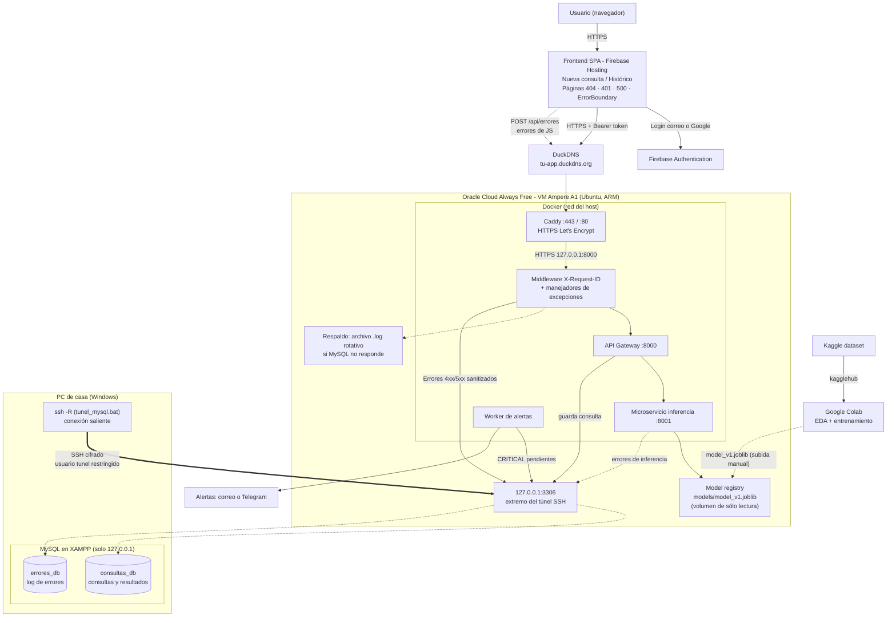
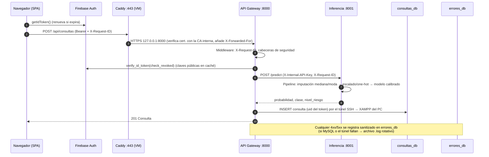

# Arquitectura

Documento de arquitectura de **Stroke Risk App**.

Diagrama editable en draw.io: [`docs/diagramas/Arquitectura.drawio`](diagramas/Arquitectura.drawio)
(se regenera con `python docs/diagramas/generar_arquitectura_drawio.py`). El diagrama siguiente es la misma vista en Mermaid.

## 1. Vista general

## 2. Componentes

| Componente | Tecnología | Ubicación | Código |
|---|---|---|---|
| Frontend SPA | React 19 + Vite, Firebase JS SDK | Firebase Hosting (HTTPS) | `frontend/` |
| Autenticación | Firebase Authentication (correo/contraseña + Google) | Google | `frontend/src/context/AuthContext.jsx`, `api-gateway/app/auth.py` |
| Dominio y HTTPS público | DuckDNS (subdominio gratuito) + **Caddy** con certificado de Let's Encrypt (renovación automática) | VM, puertos 80/443 | `infra/caddy/Caddyfile` |
| API Gateway | FastAPI, uvicorn (TLS), **contenedor Docker** | VM, `https://127.0.0.1:8000` (sólo Caddy lo alcanza) | `api-gateway/` |
| Microservicio de inferencia | FastAPI, scikit-learn, **contenedor Docker** (`python:3.12-slim`) | VM, `https://127.0.0.1:8001` (no pasa por el túnel) | `inference-service/` |
| Worker de alertas | Mismo código e imagen que el gateway (`python -m app.alertas`) | VM | `api-gateway/app/alertas.py` |
| Model registry | Archivos `.joblib` versionados, montados en el contenedor (sólo lectura) | VM: `inference-service/models/` → `/app/models` | — |
| Túnel de MySQL | SSH inverso con el cliente `ssh` de Windows | PC → VM (`127.0.0.1:3306` de la VM) | `scripts/tunel_mysql.bat` |
| `consultas_db` | MySQL/MariaDB (XAMPP) | PC, `127.0.0.1:3306` | `database/01_consultas_db.sql` |
| `errores_db` | MySQL/MariaDB (XAMPP) | PC, `127.0.0.1:3306` | `database/02_errores_db.sql` |
| Respaldo de logs | `RotatingFileHandler` (5 × 5 MB) | Volúmenes Docker `gateway-logs` e `inferencia-logs` | `app/error_logger.py` |
| Panel admin | Ruta `/admin` | Frontend + gateway | `api-gateway/app/routers/admin.py` |
| Entrenamiento | Notebook Colab + `kagglehub` | Google Colab | `ml/` |

### 2.1 Despliegue

| Proceso | Dónde / cómo corre | Escucha en |
|---|---|---|
| Inferencia, gateway, alertas | VM (Oracle, ARM): `docker compose up -d` (`network_mode: host`, `restart: unless-stopped`) | `127.0.0.1:8001`, `127.0.0.1:8000`, — |
| Caddy | VM: contenedor `stroke-caddy` (`caddy:2.10`, sólo `NET_BIND_SERVICE`) | `0.0.0.0:80` y `0.0.0.0:443` (lo único público) |
| Extremo del túnel de MySQL | VM: `sshd`, usuario `tunel` (sólo `permitlisten="127.0.0.1:3306"`) | `127.0.0.1:3306` |
| MySQL (MariaDB de XAMPP) | PC: panel de XAMPP | `127.0.0.1:3306` |
| Túnel SSH inverso | PC: `scripts\tunel_mysql.bat` (`ssh -N -R 127.0.0.1:3306:127.0.0.1:3306`) | Conexión saliente a la VM |

Los contenedores usan la red del host: comparten el loopback de la VM, así el gateway llega a la inferencia
(`127.0.0.1:8001`) y ambos a MySQL (`127.0.0.1:3306`, extremo del túnel) sin publicar puertos. En Oracle sólo se
abren 22 (SSH), 80 y 443 (Caddy), tanto en la *Security List* de la VCN como en el iptables de Ubuntu.
`infra/oracle/instalar_vm.sh` instala Docker, abre 80/443 en iptables, genera la CA y los certificados internos
(`infra/certs/`), coloca secretos y pesos subidos a la VM, guarda el dominio para Caddy, crea el usuario `tunel` y
arranca los contenedores.
El healthcheck de Docker consulta `/health` de la inferencia por HTTPS; el gateway espera a que esté `healthy`.

## 3. Flujos principales

### 3.1 Crear consulta

### 3.2 Errores

| Origen | Cómo llega a `errores_db` | Severidad |
|---|---|---|
| Gateway — `HTTPException` (401, 403, 404, 429…) | Manejador global | `WARNING` (4xx) / `ERROR` (5xx) |
| Gateway — validación 422 | Manejador global; **sólo nombres de campo**, nunca valores (datos de salud) | `WARNING` |
| Gateway — excepción no controlada | Manejador global con stack trace; al cliente sólo `request_id` | `ERROR` |
| Gateway — inferencia caída | Ruta `/api/consultas` | `CRITICAL` → alerta |
| Inferencia — fallo al cargar modelo | `lifespan` (además, el contenedor queda `unhealthy`) | `CRITICAL` → alerta |
| Inferencia — excepción al predecir | Manejador global | `ERROR` |
| Frontend — `ErrorBoundary`, `window.onerror`, `unhandledrejection` | `POST /api/errores` (límite 30/min por IP y 20 por sesión) | `ERROR` |

El **worker de alertas** (contenedor `stroke-alertas`) revisa cada 60 s las filas `CRITICAL` con `notificado = 0`,
las envía por Telegram y/o correo (SMTP con STARTTLS) y las marca como notificadas.

### 3.3 Entrenamiento y despliegue del modelo

1. Abrir `ml/stroke_prediction_colab.ipynb` en Colab → *Ejecutar todo*.
2. El notebook lee el dataset de Kaggle con `kagglehub` (sin descarga manual), hace EDA, preprocesa, compara modelos, calibra y exporta `model_v1.joblib`.
3. Subir el `.joblib` a la VM (`scp` desde el PC), `sudo bash infra/oracle/instalar_vm.sh` (lo mueve a
   `inference-service/models/`) y `docker compose restart inferencia`.
4. Nueva versión → `model_v2.joblib` + cambiar `MODEL_PATH` en `inference-service/.env` + `docker compose up -d`.
   No hace falta reconstruir la imagen: los pesos no están dentro. Cada consulta guarda `modelo_version`.

Detalle del modelo: [`modelo.md`](modelo.md).

## 4. Seguridad

| Control | Implementación |
|---|---|
| **HTTPS exclusivo** | Firebase Hosting sólo sirve HTTPS + HSTS (`firebase.json`). Caddy termina el TLS público con un certificado de Let's Encrypt y redirige `http` → `https`. Gateway e inferencia arrancan **sólo** con certificado (`run.py` aborta sin él); el healthcheck de Docker también verifica el certificado. Gateway → inferencia y Caddy → gateway verifican el certificado con la CA interna que genera `instalar_vm.sh` (nunca `verify=False`/`noTLSVerify`). El tráfico VM ↔ MySQL viaja dentro de SSH. El frontend rechaza una `VITE_API_URL` que no sea `https://` y redirige `http:` → `https:`. |
| Autenticación | ID token de Firebase verificado en cada petición (firma, expiración, audiencia, **revocación**). Cuentas de correo deben verificar el email. |
| Autorización | Las consultas siempre se filtran por el `uid` del token (un usuario nunca ve consultas ajenas; 404 en vez de 403 para no revelar existencia). Panel admin restringido a `ADMIN_EMAILS` con email verificado. |
| Superficie expuesta | Sólo Caddy (80/443) y SSH (22, sólo con llave) son públicos; gateway, inferencia y el extremo del túnel escuchan en `127.0.0.1`. La IP real del cliente sale de `X-Forwarded-For`, que uvicorn sólo acepta desde Caddy (127.0.0.1). En el PC no se abre ningún puerto: el túnel de MySQL es una conexión **saliente** y MySQL sigue escuchando en `127.0.0.1`. `TrustedHostMiddleware` rechaza Host inesperados. |
| Túnel de MySQL | Usuario `tunel` de la VM sin shell, sólo con llave ed25519 y `restrict,port-forwarding,permitlisten="127.0.0.1:3306"`: no puede abrir terminal ni reenviar otro puerto. MySQL ve las conexiones como `127.0.0.1` (usuarios de privilegios mínimos). |
| Contenedores | Usuario sin privilegios (uid 10001), sistema de archivos de sólo lectura, `cap_drop: ALL`, `no-new-privileges`, límites de CPU/RAM, imagen sin secretos ni pesos (`.dockerignore`), versión de Python fijada. |
| Servicio a servicio | `X-Internal-API-Key` comparada en tiempo constante. |
| Base de datos | Usuarios con privilegios mínimos (`app_errores` sólo `INSERT`; `app_errores_admin` sólo `SELECT` + `UPDATE(notificado)`). Consultas parametrizadas (SQLAlchemy `text()` con parámetros). |
| Cabeceras | HSTS, `X-Content-Type-Options`, `X-Frame-Options: DENY`, `Referrer-Policy`, CSP, `Cache-Control: no-store` en la API. |
| CORS | Sólo orígenes `https://` de Firebase Hosting; sin cookies (`allow_credentials=false`). |
| Privacidad en logs | Sanitización recursiva (oculta `authorization`, `token`, `password`…), truncado, IP como `SHA-256(sal:IP)`, sin valores clínicos en errores 422. |
| Secretos | `.env`, cuenta de servicio de Firebase, certificados y `.joblib` en `.gitignore`; en la VM se suben a mano y quedan con permisos `600`/`640`. La llave de la CA interna se destruye tras firmar. |

## 5. Modelo de datos

### `consultas_db.consultas`

| Columna | Tipo | Descripción |
|---|---|---|
| `id` | BIGINT PK | Identificador |
| `request_id` | VARCHAR(64) | Correlación con `errores_db` |
| `firebase_uid` | VARCHAR(128) | Dueño (índice `firebase_uid, creado_en`) |
| `gender` | ENUM(Male, Female) | Sexo |
| `age` | DECIMAL(5,2) | Edad |
| `hypertension`, `heart_disease` | TINYINT(1) | Banderas clínicas |
| `ever_married` | ENUM(Yes, No) | |
| `work_type` | ENUM(Private, Self-employed, Govt_job, children, Never_worked) | |
| `residence_type` | ENUM(Urban, Rural) | |
| `avg_glucose_level`, `bmi` | DECIMAL NULL | NULL = no informado (se imputó la mediana) |
| `smoking_status` | ENUM NULL | NULL = no informado (se imputó la moda) |
| `probabilidad` | DECIMAL(6,5) | Probabilidad calibrada 0..1 |
| `clase_predicha` | TINYINT(1) | `probabilidad ≥ umbral` |
| `nivel_riesgo` | ENUM(bajo, moderado, alto) | Banda de riesgo |
| `umbral`, `modelo_version` | | Trazabilidad del modelo usado |
| `creado_en` | DATETIME | |

### `errores_db.errores`

| Columna | Tipo | Descripción |
|---|---|---|
| `id` | BIGINT PK | |
| `request_id` | VARCHAR(64) | Mismo valor que la cabecera `X-Request-ID` |
| `origen` | ENUM(gateway, inferencia, frontend) | |
| `severidad` | ENUM(INFO, WARNING, ERROR, CRITICAL) | |
| `codigo_http` | SMALLINT | |
| `tipo`, `mensaje` | | Clase de error y mensaje sanitizado |
| `ruta`, `metodo` | | Endpoint |
| `firebase_uid` | VARCHAR(128) | Si había sesión |
| `user_agent`, `ip_hash` | | IP anonimizada |
| `stack_trace` | MEDIUMTEXT | |
| `contexto` | LONGTEXT (JSON válido) | Datos extra sanitizados |
| `notificado` | TINYINT(1) | Alerta enviada |
| `creado_en` | DATETIME | |

## 6. Decisiones de diseño

| Decisión | Motivo |
|---|---|
| Gateway + microservicio separados | El modelo (scikit-learn, pandas) se actualiza y escala por separado; el gateway no carga dependencias de ML. |
| Inferencia en Docker | Fija Python y scikit-learn (un `.joblib` sólo carga bien con la misma versión con la que se entrenó), arranca sola con la VM, se reinicia si falla y queda aislada del resto del sistema. |
| Pesos fuera de la imagen | Cambiar de modelo es copiar un archivo y reiniciar; la imagen no cambia y los pesos no se distribuyen con ella. |
| Todo menos la base de datos en Oracle Cloud | El PC de casa no tiene espacio ni debe instalar Docker, Python o Node: sólo conserva XAMPP. Una VM Always Free corre los contenedores las 24 h. |
| Gateway también en Docker | Mismo patrón y endurecimiento que la inferencia; el worker de alertas reutiliza su imagen. |
| Oracle Cloud Always Free (no Google Cloud) | Es la única opción evaluada con costo **USD 0 permanente** que acepta el túnel SSH: VM Ampere A1 (1 OCPU / 6 GB de los 2 / 12 gratuitos), disco, **IP pública** y 10 TB de salida incluidos. Google Cloud cobra la IPv4 (≈ USD 3.65/mes). La cuenta pasa a *Pay As You Go* para que Oracle no apague la VM por inactividad (sigue en USD 0). Imágenes multi-arquitectura: corren igual en ARM. Ver `manual_instalacion.md` §12. |
| DuckDNS + Caddy (no Cloudflare Tunnel) | Cloudflare Tunnel exige un dominio propio de pago; DuckDNS da el subdominio gratis y Caddy obtiene y renueva el certificado de Let's Encrypt solo. |
| `network_mode: host` + todo en `127.0.0.1` | Gateway, inferencia y el extremo del túnel de MySQL comparten el loopback de la VM: no hace falta publicar puertos ni redes Docker, y nada queda expuesto. |
| MySQL por túnel SSH inverso | La conexión sale del PC (sin abrir puertos en casa) con el `ssh` incluido en Windows, cifrada y con un usuario que sólo puede reenviar `127.0.0.1:3306`. MySQL no cambia: sigue en `127.0.0.1` y con los mismos usuarios. Coste: si el PC está apagado no se guardan consultas. |
| CA interna generada en la VM | Mantiene HTTPS entre Caddy, gateway e inferencia sin instalar mkcert; la llave de la CA no se guarda. |
| Pipeline completo dentro del `.joblib` | La imputación (mediana/moda), el escalado y el one-hot de producción son idénticos a los del entrenamiento. |
| Probabilidades calibradas | La app muestra una *probabilidad*; los pesos de clase la distorsionan y la calibración la corrige. |
| Guardar consulta aunque falle MySQL | La predicción se muestra igualmente (`guardada: false`) y el fallo queda en el log. |
| Respaldo en archivo | Si XAMPP o el túnel están caídos, los errores no se pierden. |
